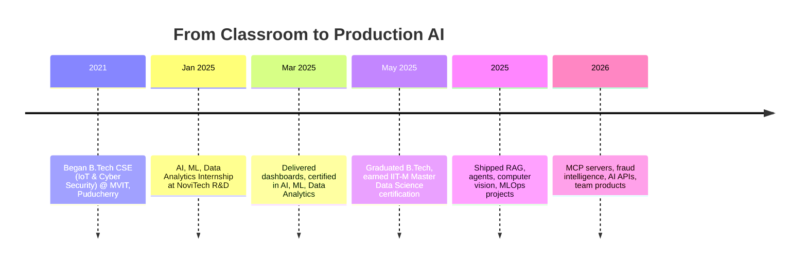

<div align="center">


<br/>

<a href="https://linkedin.com/in/ilavarasan-v-30a036257"></a>
<a href="mailto:ilavarasan.v78@gmail.com"></a>
<a href="https://6a1a851ac6565a81a7418825--beautiful-salamander-3ee0b9.netlify.app/"></a>
<a href="https://github.com/Ilavarasan-v"></a>


</div>

<br/>

## 🧭 Quick Facts

<table width="100%">
<tr>
<td width="50%" valign="top">

🎯 **Focus** — Data Science · ML · LLMs · Agentic AI · MCP
📍 **Location** — Puducherry, India · remote-ready
🎓 **Education** — B.Tech CSE (IoT & Cyber Security), MVIT
📜 **Certification** — Master Data Science, IIT-M GUVI / HCL

</td>
<td width="50%" valign="top">

🟢 **Status** — Actively interviewing for Data Scientist / AI Engineer roles
🚀 **Shipped** — 30+ AI/ML/LLM projects and services
🏙️ **Targeting** — Chennai · Bangalore · Remote
📬 **Reach me** — ilavarasan.v78@gmail.com

</td>
</tr>
</table>

## 🧠 About Me

I build AI systems that go past the notebook stage: pipelines where LLMs plan, retrieve, verify, and generate with structured reasoning instead of a single brittle prompt.

My work sits across **RAG**, **multi-agent orchestration**, **MCP servers**, **production AI APIs**, and **applied ML**. I care as much about the scaffolding around the model (self-evaluation loops, fallbacks, confidence scoring, auth, audit logging) as the model itself.

<div align="center">

</div>

## 🗺️ My Journey



## 📊 Performance Snapshot

| Metric | Value | Project |
|---|---|---|
| RAG Retrieval Accuracy | **88–92%** | CineRAG, 4-stage self-evaluating pipeline |
| Agent Reasoning Accuracy | **~90%** | Multi-Step Reasoning Agent (Planner, Executor, Verifier) |
| Image Classification | **89%** | Multiclass Fish Classifier, ResNet50 transfer learning |
| Inference Speed | **460+ tok/s** | Llama 4 Scout via Groq, Multi-Modal Agent |
| HR Attrition AUC | **~0.74** | XGBoost + SHAP, bias-audited |
| Low-confidence Flag Threshold | **< 75%** | DocMind, multi-agent LangGraph pipeline |

<div align="center">

</div>

## 🛠️ Tech Arsenal

**Languages & Data**


**AI · ML · LLMs**


**Frameworks & Tools**


## 🚀 Featured Projects

<table>
<tr>
<td width="50%" valign="top">

### 🔌 Enterprise MCP Server
**Security-focused MCP server**

FastMCP-based server exposing filesystem, database, REST API, system, and AI tools, plus prompts and resources. SQL safety validation, explicit DB permissions, audit logging, auth controls, automated tests.

`FastMCP` `Python` `SQL safety` `Audit logging`
[Repo](https://github.com/Ilavarasan-v/enterprise-mcp-server)

</td>
<td width="50%" valign="top">

### 🛡️ AI-Powered Fraud Intelligence
**ML + RAG + LLM fraud detection**

End-to-end fraud detection system combining machine learning, retrieval-augmented generation, and LLMs.

`Python` `ML` `RAG` `LLM`
[Repo](https://github.com/Ilavarasan-v/AI-Powered-Fraud-Intelligence)

</td>
</tr>
<tr>
<td width="50%" valign="top">

### 🧭 DecisionOS
**Personal AI decision engine**

Decision-support app that compares alternatives and generates personalized recommendations.

`Python` `LLM`
[Repo](https://github.com/Ilavarasan-v/DecisionOS-personal-AI-decision-engine)

</td>
<td width="50%" valign="top">

### 🔁 Self-Correcting Code Agent
**LangGraph write, test, fix loop**

AI assistant that writes code, tests it, and fixes its own mistakes in a loop until the code passes.

`LangGraph` `Python`
[Repo](https://github.com/Ilavarasan-v/Autonomous-Self-Correcting-Code-Generation-Agent-using-LangGraph)

</td>
</tr>
<tr>
<td width="50%" valign="top">

### 🎬 CineRAG
**Agentic movie recommender**

Self-evaluating 4-stage RAG pipeline: `Plan → Retrieve → Check → Generate`. ChromaDB + MongoDB hybrid retrieval, LLM scores context 0–10 and retries up to 3x. GPT-4o-mini primary, Groq Llama 3.3 70B fallback.

**► 88–92% retrieval accuracy**
`LangGraph` `ChromaDB` `MongoDB` `OpenAI` `Groq`

</td>
<td width="50%" valign="top">

### 📄 DocMind
**Multi-agent document intelligence**

Parser, Orchestrator, QA (RAG + reranking), Summarizer, Comparison, Verifier. Confidence-scored 0–100%, flags anything below 75%, page-level citations.

`LangGraph` `ChromaDB` `PyMuPDF` `FastAPI`
[Repo](https://github.com/Ilavarasan-v/Multi-Agent-Document-Intelligence-System)

</td>
</tr>
<tr>
<td width="50%" valign="top">

### 🧩 Multi-Service AI API
**One FastAPI service, three AI features**

Customer churn prediction, support ticket classification, and RAG in a single FastAPI service.

`FastAPI` `ML` `LLM` `RAG`
[Repo](https://github.com/Ilavarasan-v/Multi-Service-AI-API)

</td>
<td width="50%" valign="top">

### 📉 Churn Prediction MLOps Pipeline
**End-to-end telecom churn system**

Full ML lifecycle for predicting customer churn, built to demonstrate MLOps practices.

`Python` `MLOps` `scikit-learn`
[Repo](https://github.com/Ilavarasan-v/Customer-Churn-Prediction-MLOps-Pipeline)

</td>
</tr>
</table>

### 👥 Team Projects

- **AI-Enabled CRM Application** — full-stack CRM for contacts, leads, deals, tasks, activities, and reporting (React, Node.js) · [Repo](https://github.com/Ilavarasan-v/AI-Enabled-CRM-Application)
- **AI Video Creation Platform** — turns requirements into scripts, storyboards, AI media, and voiceovers · [Repo](https://github.com/Ilavarasan-v/ai-video-creation-platform---Team-Project)
- **Agentic Backend** — Planner, Script, and Storyboard agents with LLM orchestration and FastAPI · [Repo](https://github.com/Ilavarasan-v/Agentic-Backend)

<details>
<summary><b>📁 View all projects</b></summary>
<br/>

| Project | Stack | Highlights |
|---|---|---|
| Multi-Modal AI Agent | Llama 4 Scout · Groq · Streamlit | Any image to structured JSON, 460+ tok/s |
| AI-Powered Data Analyst | Groq · Anthropic · Pandas | Four-agent CSV analysis: chart + code + insight |
| RecallAI Memory Assistant | Groq · ChromaDB · Telegram | Episodic + semantic memory, per-user isolation |
| MCP Server Design Plan | MCP · Docker | Architecture proposal and technology research |
| Mini RAG Pipeline (TicketOps) | Python · RAG | Retrieves relevant knowledge-base context for tickets |
| LLM Ticket Classification | Python · LLM · NLP | Automatic support-ticket categorization |
| TicketOps API | FastAPI | Auth, DB performance, async, and state fixes |
| RAG Document Q&A | RAG | Document question answering |
| RAG Q&A on MongoDB | MongoDB · LangChain · Streamlit | 50,000+ records, 88–92% retrieval accuracy |
| Multi-Step Reasoning Agent | OpenAI · Groq | Planner, Executor, Verifier, ~90% accuracy |
| HR Attrition Analytics | XGBoost · SHAP · Docker | AUC ~0.74, bias audit |
| Multiclass Fish Classifier | TensorFlow · ResNet50 | Transfer learning, 89% accuracy |
| AI Study Plan Generator | FastAPI · Streamlit · Gemini | Goal to structured daily tasks |
| Document Search & Summarization | FAISS · BM25 · SBERT | Hybrid retrieval, query-focused summaries |
| PowerPulse Energy Forecast | Python | Household energy usage forecasting |
| Customer Churn EDA | Jupyter | Preprocessing and feature engineering |
| Clickstream Conversion Prediction | Python · Streamlit | Behavior to conversion prediction |
| Chicago Crime Analyzer | Power BI · PostgreSQL | Hotspots, arrest efficiency, seasonal trends |
| RedBus Data Scraper | Selenium · MySQL | Multi-state coverage, filterable UI |
| Salary Estimation (KNN) | Scikit-learn | Regression workflow, R² and MAE |
| Credit Card Analysis | Jupyter | Data analysis notebook |

</details>

## 💼 Experience

**NoviTech R&D Pvt. Ltd** — AI, ML & Data Analytics Intern · Jan – Mar 2025 · Coimbatore (Remote)
- Built and evaluated end-to-end ML models across 3 course modules, from ingestion to evaluation
- Applied 5+ feature engineering techniques across multiple business datasets
- Tuned and compared 3+ model configurations per task with documented metrics
- Delivered 2 Power BI dashboards adopted for stakeholder decision-making
- Built reporting pipelines that cut manual data-prep effort across 2 business units

## 🎓 Education & Certifications

| Credential | Institution | Period / Date |
|---|---|---|
| B.Tech CSE — IoT & Cyber Security | Manakula Vinayagar Institute of Technology, Puducherry | 2021–2025 · 8.03 CGPA |
| Master Data Science + Advanced Programming | IIT-M GUVI, Chennai | 2024–2025 |
| Artificial Intelligence, Data Analytics, Machine Learning | NoviTech R&D | Mar 2025 |

## 📈 GitHub Stats & Activity

<div align="center">


</div>

## 🧗 Currently Learning

```
Multi-Agent Orchestration   → LangGraph state machines · tool calling · handoffs
MCP & Agent Tooling         → FastMCP · secure tool design · permissions
MLOps & Deployment          → Docker · FastAPI · CI/CD for ML pipelines
Advanced RAG                → GraphRAG · hybrid BM25+FAISS · re-ranking
```

<div align="center">

### 🟢 Open to remote, hybrid, or relocation — let's talk

<a href="mailto:ilavarasan.v78@gmail.com"></a>
<a href="https://linkedin.com/in/ilavarasan-v-30a036257"></a>


</div>
